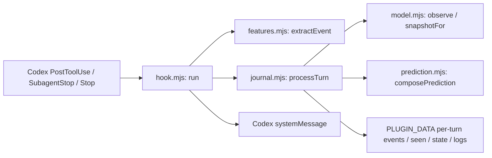

# Architecture snapshot (2026-10-10, version 0.2.0)

This is a portable summary of the 0.2.0 repository on 2026-10-10. The
portable [Software Graph](ontoly/SoftwareGraph.json) is checked in. Ontoly's
raw `.ontoly/SoftwareGraph.json` is ignored by Git because it contains the
builder's absolute workspace path. Rebuild it locally with:

```sh
pnpm dlx @0xsarwagya/ontoly-cli@1.3.5 build . --output .ontoly
pnpm dlx @0xsarwagya/ontoly-cli@1.3.5 coverage .
pnpm dlx @0xsarwagya/ontoly-cli@1.3.5 stats . --json
```

Graph hash `0lhq8ug`: 28 indexed files, 88 nodes, 151 relationships, no
cycles or diagnostics. Structural coverage, consistency and trustworthiness
reported 100%. These are parser and graph-quality checks, not a validation of
the attribution model. The portable copy changes only `repository.root` and
the workspace node's `metadata.root` to `.`; it contains no absolute Windows
path or private review-service address.



| Graph evidence | Relationship | Source span |
| --- | --- | --- |
| `fn:plugins/codex-step-risk/scripts/hook.mjs:run` → `fn:plugins/codex-step-risk/scripts/features.mjs:extractEvent` | `CALLS` | `hook.mjs:36` |
| `fn:plugins/codex-step-risk/scripts/hook.mjs:run` → `fn:plugins/codex-step-risk/scripts/journal.mjs:processTurn` | `CALLS` | `hook.mjs:40` |
| `mod:plugins/codex-step-risk/scripts/journal.mjs` → `mod:plugins/codex-step-risk/scripts/model.mjs` | `IMPORTS` | `journal.mjs:7` |
| `fn:plugins/codex-step-risk/scripts/journal.mjs:predictionFor` → `fn:plugins/codex-step-risk/scripts/prediction.mjs:composePrediction` | `CALLS` | `journal.mjs:56` |
| `fn:plugins/codex-step-risk/scripts/hook.mjs:run` → `env:PLUGIN_DATA` | `READS` | `hook.mjs:38` |

The graph now captures the call from the hook into per-turn persistence and
the prediction composer. The `hooks/hooks.json` registration, file-write
ordering and user-visible message semantics are verified from source and
process tests rather than inferred from graph relationships. Complete runtime
flow confidence is medium.

The live path has no outcome-label ingestion or calibrated failure-risk model.
It observes tool and subagent completion boundaries only. The offline GFA
review service is not called from the hook and is not represented as a runtime
dependency in this graph.
