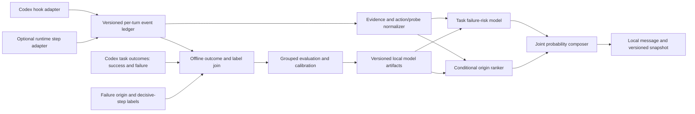

# Step Risk v2: observable attribution and a path to calibration

Historical research design, superseded for the product by [the 0.4.0 contract](STEP_FAILURE_V04_SPEC.md). Version 0.4.0 estimates each step's potentially overlapping failure contribution directly through a conditional factor chain. It does not derive the new probability from the legacy origin distribution. The calibration gate below is a historical proposal for a different joint-origin model, not a prerequisite for displaying the current model estimates.

## Objective and probability contract

After each **observable** agent boundary, report three separate quantities:

- `taskFailureRisk(t) = P(Y = failure | H_t)`, where `H_t` is the information
  available through that boundary.
- `conditionalOrigin(i, t) = P(C = i | Y = failure, H_t)`, where `C` is the
  human-defined primary origin of failure. Its categories must be mutually
  exclusive; if annotation permits multiple co-origins, define a separate
  multi-label target rather than normalizing them as one categorical variable.
  The distribution must include visible candidate steps, unobserved agent
  activity, external or infrastructure
  causes, and future steps. `decisive_step` is a separate label, not an alias
  for `origin_step`.
- `jointOriginFailure(i, t) = taskFailureRisk(t) * conditionalOrigin(i, t)`.
  This is the probability of a future failure *attributed to* step `i` under
  the stated annotation policy. It is not the counterfactual probability that
  the step *causes* failure; that stronger claim would require an intervention
  or a defensible causal identification strategy.

These values must not be conflated. A failed probe can reveal an earlier
mistake; it does not automatically become the origin. A successful task has
`Y != failure`, so failure-only trajectories cannot calibrate
`taskFailureRisk` or the joint probability. Until matched successful and
failed Codex trajectories exist, those two fields are **unavailable** rather
than numeric percentages. An experimental ranking score may be shown
separately with its status and model version. Even the conditional-origin
weights must not be called calibrated probabilities until they pass a
held-out, failure-only calibration check under the same observation policy.

## Available evidence and limits

The available review service listed 322 trajectories on 2026-10-10. Of these,
145 had completed review; all completed reviews had `official_score = 0`.
There are currently no successful trajectories available. The reviewed
failures carry manual `origin_step` and `decisive_step` labels. They can test
label definitions, failure mechanisms, the unobserved bucket, and offline
ranking baselines. They cannot estimate the base rate of failure, calibrate
`taskFailureRisk`, or validate `jointOriginFailure`.

The corpus comes from other agent frameworks and contains internal model
response, reasoning, and planning steps that Codex tool hooks do not expose.
Many labelled origins therefore have no matching plugin event. Before using
these labels to evaluate the hook-only ranker, map each trajectory onto the
same observable event types and report the fraction of origins that remain
visible. Keep unmatchable origins in an explicit unobserved bucket; never
silently drop them. Do not copy private trajectory text or the review service
address into this repository.

| Available data | Suitable use | Unsuitable use |
| --- | --- | --- |
| Reviewed GFA failures | Define `origin_step` versus `decisive_step`; inspect mechanisms and unobserved coverage; compare failure-only ranking baselines | Failure base rate, task-risk calibration, or a deployed Codex probability |
| Codex hook snapshots without terminal outcomes | Check event coverage, persistence, privacy, and latency | Supervised probability training or accuracy claims |
| Future consecutive Codex tasks with verified terminal outcomes | Estimate and calibrate task failure risk, including its true base rate | Origin attribution for successes, where no failure origin exists |
| Future failed Codex tasks with origin labels | Train and evaluate conditional responsibility under the same observation boundary | A standalone estimate of task failure risk |

The present Codex plugin observes `PostToolUse`, `SubagentStop`, and `Stop`.
Its honest live scope is these hook boundaries. Keep it as a lightweight
telemetry adapter and feedback surface for the first release. If the product
must score every model response, planning decision, and tool action, add a
separate runtime event adapter with a stable step ID, parent/child links, and
completion signal. The plugin cannot infer hidden steps from a tool result.
Until that adapter exists, describe the output as **per observed boundary**,
not per agent step.

## Proposed architecture

### Hook adapter and journal

The hook adapter emits one versioned event per host event with `sessionId`,
`turnId`, `eventId`, event kind, tool or agent identity if available, a
normalized outcome of `error`, `success`, or `unknown`, and evidence quality.
It must distinguish an intervention from a probe only when structured host
metadata supports that distinction; otherwise use `unknown`. Keep raw prompt,
tool arguments, response bodies, and transcripts out of the journal by
default. Retain an explicit unobserved category in every prediction.

Persist an append-only, idempotent event journal per session and turn. Keep an
incremental derived snapshot on the normal path; replay only committed events
after the snapshot's last ordinal when recovering from an interrupted write.
This avoids rereading the entire turn on every hook. Key state and locks by
both session and turn; accept late events for an older turn without resetting
a newer one. Record event ordering, schema version, model version, and
diagnostic status.

### Online estimators

The failure-risk model consumes only prefix features available at time `t`.
It needs success and failure trajectories from the same Codex observation
contract, sampled from the task population where the plugin will run. The
offline outcome join must use a stable task ID and a terminal outcome policy;
`Stop` means the turn ended, not that the task succeeded. Include aborted,
partial, and infrastructure outcomes as explicit classes or exclusions with
documented rules. Collect successful Codex tasks now, including tasks with
no tool errors, without requiring origin labels for those successes. Sample
consecutive eligible tasks rather than curating only failures; otherwise the
failure base rate is distorted. Store a minimal outcome record with `taskId`,
`outcome`, `outcomeSource`, `policyVersion`, and completion time, then join it
to hook snapshots through a stable task identifier. Human acceptance or a
task-specific verifier may establish success; an absence of errors cannot.
Train and calibrate offline; load a small versioned artifact in the local
hook. No per-step network request to a review or training service belongs on
the hook path.

The origin ranker compares candidate interventions and the unobserved,
future, and external buckets. A structured tool error is evidence of a
problem; its weight should be routed to plausible preceding interventions
as well as the current event according to provenance. A probe's error must
not receive an automatic causal bonus. If provenance is unavailable, abstain
or retain mass in the unobserved bucket. Train `origin_step` and
`decisive_step` as distinct targets if both are needed.

The composer emits the joint value only when both component estimates have
passed their respective calibration gates. Every snapshot includes the
prediction time, observation coverage, calibration status, and model/data
version. Missing evidence must never be treated as a successful action.

### Evaluation gates

Split by whole task, not by step prefix, and keep repeated task IDs or near
duplicates in one split. Prefer a later time window and project holdout for
deployment checks. Report failure-risk Brier score, log loss, and a
reliability plot against a task/base-rate baseline. Check calibration at
fixed prefix positions or elapsed-time bins so long tasks do not dominate.
For failed tasks, report origin Top-1/Top-3, ranking quality, visible-label
coverage, and residual mass against simple baselines such as latest error and
latest intervention. Evaluate the joint event on held-out successes and
failures only after both components pass their own gates.
Evaluate task, infrastructure, and partial outcomes separately. Track
abstention and end-to-end p50/p95 hook latency on a real Codex host.

The first usable release should prioritize a trustworthy event journal and
honest output status. Numeric joint probabilities are a later gate requiring
successful Codex trajectories and held-out calibration evidence. GFA failure
reviews remain useful for annotation-policy design and failure-only ranking
experiments, with their cross-framework and coverage limitations reported.
